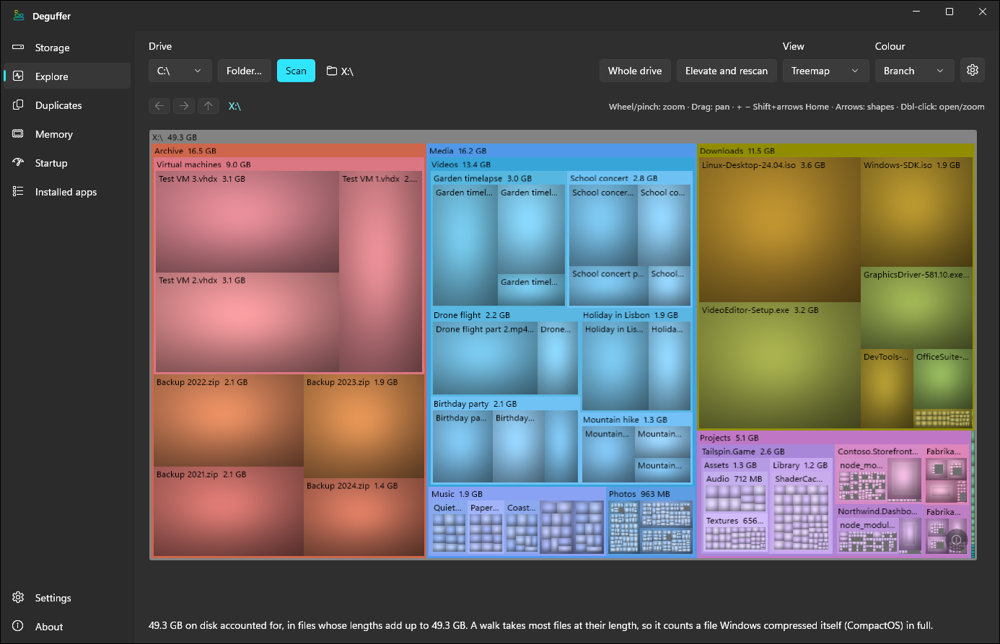
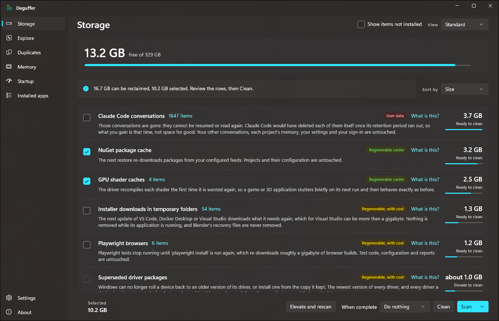
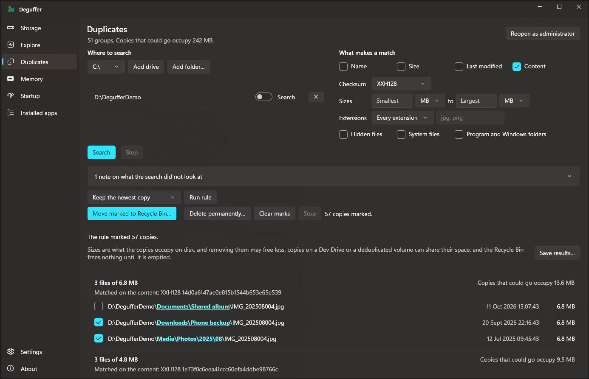

# Deguffer

Deguffer is a disk cleaner for Windows. It works out what is filling your drive and helps you get
the space back without losing anything you wanted to keep. It knows about the caches, build output,
downloads and leftovers that applications and Windows leave behind, explains what each one is and
what you would lose by deleting it, and then leaves the decision to you. It can also map a whole
drive, find duplicate files, tidy up the list of installed programs, and show you where your memory
is going.

The name comes from *guff*, British slang for rubbish: the stuff that piles up and serves no
purpose, which is what Deguffer clears away.

> [!WARNING]
> **Deguffer is beta software, and it deletes files and folders.** It is designed to remove only what
> you choose and to check afterwards that everything it promised to leave alone is still there, but
> it may still have faults, and a removal may not be reversible. Back up anything you cannot afford
> to lose before you use it. Deguffer is provided under the MIT licence "as is", without warranty of
> any kind, and its authors accept no liability for any loss of data or other damage that results
> from its use.

Deguffer runs on Windows 10 (version 1809 or later) and Windows 11, and it is free and open source
under the MIT licence. Download the zip for your processor from the
[releases page](https://github.com/BootBlock/Deguffer/releases), extract it and run
`Deguffer.App.exe`. There is nothing to install. Most PCs need the `win-x64` zip; use `win-arm64` on
an ARM processor, and `win-x86` only on 32-bit Windows. The release files are not code-signed, so
Windows SmartScreen may warn you the first time you run Deguffer, and each release includes a
`SHA256SUMS.txt` file you can check the download against. You can also
[build it from source](#building).

Here is the Explore page showing a drive as a treemap, with each folder's share of the space and the
largest files inside it:



## What it does

Besides Settings and About, Deguffer has six pages:

- [Storage](#storage) checks 117 sources of waste, from package-manager and browser caches to
  `Windows.old` and old restore points, and puts each one in a [safety tier](#safety-tiers). You
  choose what goes, and when the clean has finished Deguffer checks that everything it said it would
  leave alone is still there.
- [Explore](#explore) draws a drive or folder as a treemap, an icicle or a sunburst chart, or lists
  its largest files at any depth. It shows what has grown since an earlier scan and which kinds of
  file take up the space, and it can move what you pick to the Recycle Bin.
- [Duplicates](#duplicates) finds files that are stored more than once, matching them by name, size,
  date or content. Before it removes a copy you marked, it compares that copy byte for byte with the
  one you are keeping.
- [Installed apps](#installed-apps) finds entries in Windows' list of installed programs whose
  programs are provably gone. It backs each entry up before removing it unless you turn that off,
  and it can run a program's own uninstaller when you ask it to.
- [Memory](#memory) shows where physical memory is going, by application, by service and to Windows
  itself, and can ask a program you choose to close.
- [Startup](#startup) lists what Windows starts when you sign in, along with how much memory each
  running program is using. It can stop an entry from starting in the same way Task Manager does,
  without deleting it.

Deguffer starts without administrator rights. Storage, Explore and Duplicates can restart it as
administrator so that it can read a drive's file table directly, which makes scanning much faster,
and so that Storage can run the Windows cleanup steps that need those rights. Installed apps can
restart it in the same way to remove entries that belong to every account, and Startup can do so to
change entries that start for every account.

## Why it exists

Windows' own Disk Cleanup and Storage Sense know about Windows' caches and not much else. On a
working machine, most of the waste is in application and package caches, downloaded toolchains and
runtimes, editor state, container images and search indexes, and each of those needs specific
knowledge to clear safely.

Deguffer started as an audit of a Windows 11 workstation that was down to 5.6 GB free on a 330 GB
system drive. Clearing three package-manager caches in the way each tool intends recovered 22.9 GB
in a few minutes, without touching any user data. The same audit very nearly deleted 11 GB of VS
Code's `workspaceStorage` folder, which looks like a cache but mostly contains AI chat history, and
nothing about its path, size or name suggests that. A cleaner that ranks folders by size would have
recommended deleting it, and that near miss is the reason Deguffer classifies everything before it
offers anything.

## Safety tiers

| Tier | What it is | What deleting it costs | Default |
| --- | --- | --- | --- |
| **1. Regenerable cache** | Recreated by whatever made it, when it is next needed | A slower next use | Offered and pre-selected |
| **2. Regenerable, at a cost** | Recreated by downloading or rebuilding, often several gigabytes | Time and bandwidth | Offered, not pre-selected |
| **3. User data** | Logs, histories and saved sessions that *look* like a cache | It is gone for good | Offered, never pre-selected |
| **4. Do not touch** | Settings, credentials and live state | Things stop working | Never shown |

Some rows were written from a tool's documentation, its source code and its users' reports,
because nobody working on Deguffer had seen its folders on a real installation. Each of those rows
carries a **Researched** chip and is never pre-selected, whatever its tier.

Anything Deguffer does not positively recognise is treated as Tier 4, so it is left alone by
default instead of depending on someone having remembered to exclude it. Outlook's `.ost` and
`.pst` files are also protected by name, because they can be saved anywhere, and Deguffer will never
remove one by any route.

## How it stays safe

- Where a tool has its own command for clearing its cache, Deguffer uses that command.
  `dotnet nuget locals all --clear` cleared four locations, two of them outside `.nuget`, and a
  cleaner working from paths alone would have missed about 3 GB.
- It never deletes a tool's root folder, only the folders inside it that it recognises. The `.gradle`
  folder, for example, keeps its disposable `caches` and `wrapper` folders next to
  `gradle.properties`, which can contain signing keys.
- Nothing is deleted until a scan has shown you what it is, and you can read the exact steps for
  each row before you agree to them.
- After each clean, it checks that the tool's root folder, anything it did not recognise and
  anything in Tier 4 are all still there, and it names any check that failed.
- Files that Windows has locked are skipped, never forced.
- Every path is handled in Windows' long-path form. NuGet and Node folder trees often go past the
  260-character limit, and a path cut short there would cause a partial deletion that nobody would
  notice.
- Anything you put on the keep list, such as a Playwright browser build or an older version of an
  application, is left out of every clean until you release it in Settings.
- A Storage clean deletes outright and cannot be undone. Explore and Duplicates use the Recycle Bin
  by default. If the bin cannot take an item and Windows would delete it permanently instead, they
  leave the item where it is and tell you why.
- You can set a clean to close Deguffer, or to lock, log off, sleep, hibernate, restart or shut down
  the PC, when it finishes. Deguffer waits 30 seconds first so that you can cancel, does nothing if
  the clean's checks failed, and never forces a program to close.
- The Memory page is not a RAM cleaner. It never trims a program's memory or flushes Windows' memory
  lists, never describes a process as idle or safe to close, and never touches a service.

## Storage

Each of the 117 sources has its own provider, which knows what that location is and what sits next
to it. Rows for tools you do not have are hidden unless you ask the Storage page to show them. Build
output and project caches, such as `node_modules`, `obj`, Rust's `target`, Python's `.tox` and
`.pytest_cache` folders, and the caches in Visual Studio's `.vs` folders, are only looked for
inside the source folders you add in Settings.
[What Deguffer cleans, and what it costs you](docs/cache-locations.md) describes most of these
sources in more detail.

After a scan, each row on the Storage page gives the location's size and safety tier, and says what
you would lose by deleting it. By default, only Tier 1 rows that are not marked Researched start out selected:



<details>
<summary><b>Tier 1: regenerable caches</b></summary>

| Source | Notes |
| --- | --- |
| NuGet package cache | Cleared with `dotnet nuget locals all --clear`, not by path |
| npm package cache | Cleared with `npm cache clean --force` |
| pnpm store | Researched |
| Yarn 1 package cache | Cleared with `yarn cache clean`, only where the `yarn` on your PATH is Yarn 1, never Yarn 2 or later. Researched |
| Bun install cache | Cleared with `bun pm cache prune`, which keeps Bun's global store; needs Bun 1.4.4 or later. Researched |
| Composer package cache | Cleared with `composer clear-cache`, only where every folder it empties is Composer's own |
| Arduino downloads and build cache | Downloaded archives cleared with `arduino-cli cache clean`, only where the downloads folder holds nothing but the archives the CLI stages there; build-cache entries only where the CLI's `.last-used` marker is inside; never the data folder with your installed boards, or your sketchbook. Researched |
| Scoop download cache | Cleared with Scoop's own cache command, only where everything in the cache is a download Scoop made; installed apps are not touched. Researched |
| Gradle build cache | `caches` and `wrapper` only, never the Gradle user home itself: `.gradle`, or wherever `GRADLE_USER_HOME` points |
| Cargo crate cache | Researched |
| Go build and module caches | Researched |
| Zig build cache | Never the packages Zig fetched. What it built is removed only together with the records that point to it. Researched |
| Deno cache | By path, never with `deno clean`, which also deletes what Deno programs saved and your REPL history; left alone while Deno is running. Researched |
| Electron downloads | The runtime zips Electron's installer keeps, one folder per version; never the layouts older installers left next to them |
| TypeScript typings cache | One folder per TypeScript version; never one that a running program is working in |
| Nx shared task caches | The `cache` folder in each workspace's folder in `%USERPROFILE%\.nx`, only where Nx's own `terminalOutputs` folder is inside and the Nx that reads its index is 23.3 or later; never the index, `.nx` itself, or a cache whose index Nx has open. Researched |
| ccache compiler cache | Cleared with `ccache --clear`, which keeps its settings. Researched |
| sccache compiler cache | sccache's server is stopped first; never its settings. Researched |
| Debugger symbol cache | The symbol files and programs that debuggers downloaded into a store that only Microsoft's public symbol servers fill, as `_NT_SYMBOL_PATH` names it; never the store's markers or anything else in it, a store that SymStore built, or anything while a debugger that writes to the store is running |
| Conan package cache | Conan's own cache clean, limited to sources, build folders and unfinished builds; the packages you built or downloaded stay, with their metadata and your configuration. Researched |
| pip package cache | |
| uv package cache | |
| Poetry package cache | `poetry cache clear` for each repository; never its `virtualenvs`. Researched |
| pre-commit hook environments | Cleared with `pre-commit gc`, which keeps the hooks a project still uses; never `pre-commit clean`, which also deletes the unstaged changes pre-commit stashed during a commit. Researched |
| pytest caches | `.pytest_cache` folders under your own source folders, only where pytest's own cache tag is inside and a pytest settings file is next to it. Researched |
| mypy caches | `.mypy_cache` folders under your own source folders, only where mypy's own cache tag is inside and a mypy settings file is next to it. Researched |
| ruff caches | `.ruff_cache` folders under your own source folders, only where ruff's own cache tag and `.gitignore` are inside and a ruff settings file is next to it. Researched |
| Nx workspace task caches | `.nx\cache` beside an `nx.json` under your own source folders, only where Nx's own `terminalOutputs` folder is inside and the Nx that reads its index is 23.3 or later; never the rest of `.nx`, and nothing while Nx is running in the workspace. Researched |
| .NET intermediate build output | `obj` folders under your own source folders |
| Visual Studio solution caches | Inside the `.vs` folder beside a solution under your own source folders: the design-time build and project evaluation caches, the Find in Files index, and the C++ browsing database and precompiled headers, each only where the files inside it are the ones Visual Studio writes; never Copilot conversations or snapshots, solution options or window layouts, and nothing while the solution is open |
| Dart analysis server cache | |
| Roslyn solution index cache | One dated row per set of indexes, so that sets left behind when a program moved folder can go; never the rest of Visual Studio's folder |
| Superseded JetBrains IDE caches | The caches, indexes and temporary files of IntelliJ-based IDE versions an update replaced, Android Studio's included, once nothing in them has changed for 180 days; never local history, logs, settings, plugins or licences |
| VS Code editor caches | |
| VS Code C/C++ IntelliSense cache | |
| VS Code extension browsers | The Chromium build that an extension such as Cline downloaded and will download again by itself; never the extension's conversations, checkpoints or settings, or a build that a running browser is using |
| Chromium application caches | Chrome, Edge, Brave, Vivaldi and Opera, the built-in browsers in the Steam client and the Battle.net launcher, and every application that embeds the same engine, including WebView2 and packaged applications. Never their sign-ins, saved passwords or payment cards |
| Firefox caches | |
| Thunderbird caches | The cache, startup cache and Safe Browsing lists in each profile's local half; never your mail, address books, calendars, saved passwords or OpenPGP keys |
| Steam HTTP cache | The client's own cache next to the program; never your games, your cloud saves, or the sign-in kept by its built-in browser |
| Spotify streaming cache | Never the music and podcasts you downloaded, wherever Spotify's settings put them. Researched |
| Plex Media Server transcoder files | `Transcode\Sessions` and the resized pictures; never anything written in the last 24 hours, the sync queue next to it, or the downloads folder. Researched |
| Jellyfin transcoder files | Only a folder that carries Jellyfin's own marker; never anything written in the last 24 hours. Researched |
| Emby Server transcoder files | Only a `transcoding-temp` folder that Emby made; never anything written in the last 24 hours. Researched |
| Redshift texture cache | The numbered folders of textures Redshift converted to its own format, in its standalone cache, in the cache inside each Maxon application's preferences, and where `REDSHIFT_CACHEPATH` points, if Redshift's mesh cache is there too; never anything else in `Textures`, the mesh cache, preferences or logs next to them, a cache on another computer's disk, or anything while a program that renders with Redshift is running. Redshift converts each texture again at the next render |
| Epic Games launcher web cache | |
| Epic Games launcher store artwork | Machine-wide, under `%PROGRAMDATA%`, and shared by every account |
| Battle.net launcher cache | Never the launcher's account data, its database, or anything under `%PROGRAMDATA%` |
| GPU shader caches | |
| Squirrel updater leftovers | Staging folders that an interrupted update left behind |
| Tool caches in temporary folders | Node's compile cache, and what Flutter, Dart's test runner, Firefox and Roslyn left there, each recognised by its own name and left alone while its tool may be using it |
| Claude Code session leftovers | Only what ended sessions and editors left behind; never a conversation, its memory or your sign-in |
| Claude Code command snapshots | The project snapshots that Claude Code fails to remove when it exits; only those made before every running session started, or that Claude Code had started to remove |
| Test browser profiles | The profiles that Playwright and Puppeteer leave in a temporary folder when a test run is stopped; never one that Deguffer can see a running browser using |
| Delivery Optimization cache | Cleared with Windows' own command and sized by Windows' own figure; never a file Windows was told to keep, and never Windows Update's own folder |
</details>

<details>
<summary><b>Tier 2: regenerable, at a cost</b></summary>

| Source | Notes |
| --- | --- |
| Maven local repository | Researched |
| Conda package cache | Researched |
| Debugger symbol cache, other servers | The same, in WinDbg's own store, Visual Studio's symbol cache, and any store that another server fills. A private server may no longer keep an old build's symbols, so the copy here may be the last one |
| Chromium offline site storage | What sites' service workers stored so that they work offline, in the same browsers and applications as the Chromium caches row; a web application that worked offline will not do so again until it is next opened online |
| vcpkg build caches | Researched |
| PlatformIO cache and unused packages | PlatformIO's own prune decides which installed packages are no longer needed |
| Affinity machine-learning models | The `modelcache` next to your asset library, never the version folder that contains both |
| DaVinci Resolve render cache | Each project's render files in a `CacheClip` folder at the root of a drive or in your Videos folder; never optimised media, proxies, backups or recordings, and nothing while Resolve is running. Resolve renders them again only while your media is connected. Researched |
| After Effects disk cache | Each version's cache named for this computer, only in the folder that After Effects' own preferences name; never anything next to it or above it, and nothing while After Effects is running. After Effects renders the frames again as you preview. Researched |
| Adobe media cache | The converted audio, waveforms and database shared by Premiere Pro, After Effects, Audition and Media Encoder, wherever Adobe's settings put them; never your LUTs, templates or Team Projects' auto-saves, and nothing while an Adobe application is running. Each project opens slowly once while Adobe converts its audio again. Researched |
| CapCut editing cache | Thumbnails, waveforms and the audio extracted for subtitles in CapCut's and Jianying Pro's `User Data\Cache`, and nothing while either is running; never your drafts, settings, downloaded effects or imported media. Researched |
| Capture One previews and thumbnails | The `Cache` in each catalog and session that Capture One lists, wherever it is; never the photographs or the adjustments next to it. A catalog whose originals are offline cannot be browsed until they are reconnected. Researched |
| Playwright browsers | |
| Puppeteer browsers | The builds in `.cache\puppeteer`, never the rest of `.cache`; never a build that a running browser is using, or the metadata Puppeteer uses to find its builds. Researched |
| LM Studio superseded runtimes | Every llama.cpp build LM Studio has downloaded except the one it uses and the newest for each kind of hardware, removed by LM Studio's own command. LM Studio must be open, and it frees the space the next time it starts |
| Azure Functions Core Tools releases | |
| Vagrant superseded box versions | Vagrant's own prune, which keeps the newest version of every box; nothing while a machine Vagrant knows about was made from a version the prune would remove. Researched |
| Graphics driver installer files | What NVIDIA's and AMD's installers unpacked or downloaded and left behind; never AMD's chipset install source or the NVIDIA app's update store. Researched |
| Autodesk installer files | What Autodesk's installers extracted into `C:\Autodesk` and left behind; never the network licence server, an administrator's deployment images or Autodesk Access's updates. A repair or an update then downloads the product again. Researched |
| Steam library artwork | One item per game, fetched again when Steam next shows it; never Steam's index of it. A picture you replaced by hand is lost, so keep that game |
| Steam shader pre-cache | One item per game, in every library listed by Steam itself; never the games next to it |
| Emulator shader caches | What Cemu, RPCS3, Dolphin, PCSX2, DuckStation, PPSSPP, Vita3K, Ryujinx, Eden, Citron, yuzu, Azahar, Lime3DS and Citra compile for your GPU, and Ryujinx's translated code, found where each one keeps its data and in the emulator folders you add in Settings; never Cemu's or a 3DS emulator's transferable cache, a Switch emulator's guest shader cache, DuckStation's achievement record, saves, memory cards, firmware or Dolphin's own `Shaders`, and nothing while the emulator is running. Researched |
| RetroArch shaders and game databases | The shader sets and `.rdb` databases its Online Updater downloaded, found through Steam's records and the emulator folders you add in Settings, in the folders named by its own `retroarch.cfg`; never the presets you saved, `system`, cores, cheats, overlays or saves, and nothing while RetroArch is running. Researched |
| Unreal Engine derived data cache | The cache that every project shares, in both the older folder and each Zen store; a store is left alone while its server is running. Researched |
| Unity GI cache | The lighting cache that every project shares, in `%LOCALAPPDATA%\Unity\Caches\GiCache`, and nothing while a Unity Editor is running; never the build cache next to it. A cache moved in Unity's preferences is named, never removed. Researched |
| Node.js project dependencies | `node_modules` under your own source folders |
| Python virtual environments | |
| tox environments | `.tox` folders under your own source folders, only where tox's own cache tag is inside and a tox configuration is next to it. Researched |
| nox environments | `.nox` folders under your own source folders, only where nox's cache tag and `.gitignore` are inside and a `noxfile.py` is next to it. Researched |
| Dart and Flutter tool folders | `.dart_tool` folders under your own source folders, only where pub's own package configuration is inside, `pubspec.yaml` and `pubspec.lock` are next to it, and git tracks nothing inside it |
| Git LFS old file versions | Old versions of large files in `.git\lfs\objects` in the Git repositories under your own source folders, removed only by Git LFS's own prune after the repository's server confirms it still holds each one. A repository whose remote is a folder, whose store is shared, or that something is working in is left alone |
| Rust build output | `target` folders under your own source folders |
| Unity project library | |
| Unreal project intermediate files | `Intermediate` next to a `.uproject` under your own source folders; never `Saved` or `Binaries`. Researched |
| Unreal project derived data cache | A project's own `DerivedDataCache` under your own source folders. Researched |
| Superseded application versions | Older versions that a Squirrel-updated app still keeps |
| CapCut superseded builds | Older builds of CapCut and Jianying Pro in `Apps`, never the build its launcher starts or the newest, and nothing while it is running. Researched |
| Temporary files | Emptied in place, taking only what nothing has touched for seven days; anything a tool's own row offers is left to that row |
| Installer downloads in temporary folders | Updates that VS Code, Docker Desktop and the Visual Studio Installer downloaded, and Blender's crashed sessions, only while the application is closed; never Blender's recovery files |
| Previous Windows installation | `Windows.old` and Setup's leftovers, removed by Windows' own Disk Cleanup handlers once the upgrade can no longer be undone and no update is unfinished |
| Leftover Windows update folders | `$WinREAgent` and `$GetCurrent`, which Microsoft does not document. They are offered on Deguffer's own stated judgement, as a whole, once nothing inside has changed for 30 days |
| Superseded driver packages | Older versions of drivers in Windows' driver store, removed by Windows' own Disk Cleanup handler; never the newest version of a driver, one that a device is using, or one that is part of Windows |
| Superseded Windows components | The component store (`WinSxS`), reduced by `DISM /StartComponentCleanup` as administrator and sized by DISM's own analysis, which counts what the store shares with Windows only once; nothing is ever deleted from the store |
| Local copies of cloud files | OneDrive's own "free up space": every file stays listed and opens while you are online. Files you keep on this device, and files with changes not yet uploaded, stay as they are |
</details>

<details>
<summary><b>Tier 3: user data, and anything else you cannot get back</b></summary>

| Source | Notes |
| --- | --- |
| Recycle Bin | |
| Windows update uninstall data | `DISM /StartComponentCleanup /ResetBase`, as a separate row because afterwards no update installed so far can be uninstalled |
| Older restore points | Every restore point except the newest, removed one at a time by System Restore itself as administrator; never the newest, a shadow copy that cannot belong to a restore point, or System Protection's limit |
| Other accounts' profiles | Every other account's profile is listed with its size, last use, and whether its account exists and is in use. Only a local account Windows says no longer exists is offered, removed by Windows' own profile removal as administrator, one profile at a time; never a profile in use, the account Deguffer runs as, a domain or work account, or a folder by path |
| Windows File History | Windows' own command removes saved versions older than an age you set; the backup drive itself is never touched. Researched |
| Files discarded by a Windows upgrade | What an upgrade set aside instead of moving, which can include your own files. Removed by Windows' own Disk Cleanup handler, and only once the upgrade can no longer be undone |
| Crash dumps and error reports | |
| Windows servicing logs | The logs that a reset of this PC leaves behind, cleared by Windows' own cleanup for them, never by path |
| VS Code editor logs and crash reports | |
| Epic Games launcher logs and crash reports | |
| Battle.net launcher logs | |
| RetroArch thumbnails | Each system's box art, snapshots, title screens and logos, grouped by system. Most will download again, but a picture you added yourself cannot be told apart from the rest and will be lost. Researched |
| Hugging Face models and datasets | One item per repository in the hub cache that Transformers, Diffusers and other Python tools download into, removed by Hugging Face's own `hf cache rm`, version 1.32 or later; never a repository a running program has open, the store of files that repositories share, or your access tokens. A model that has been withdrawn or made private cannot be downloaded again |
| Claude Code MCP server logs | |
| Tool logs in temporary folders | The Remote Desktop client's traces, the Windows App's and ServiceHub's logs, and VS Code's updater logs; the folders they are written to stay |
| Claude Code rewind snapshots | One folder per session, dated by the folder and never by the snapshots in it; a running session's snapshots are never offered |
| WSL and Docker virtual disks | Reported, never acted on: each disk's size on the drive, whether it is sparse, how much Docker says can be reclaimed inside it when Docker Desktop is already running, and the vendor's commands in the order to use them. Nothing is pruned, compacted or deleted |
| Claude Code conversations | One item per session, by its title and project, for when you want one gone before Claude Code deletes it after 30 days; never one that is running, one in a project Claude Code is running in, or one used this week |
</details>

## Explore

Explore reads the drive's file table when Deguffer is running as administrator, and walks the
folders when it is not. You can view a whole drive or a single folder as a treemap, an icicle, a
sunburst or a list, and colour it by folder, age, growth, file type or depth. The Files view lists
the largest files at any depth, and you can filter it by name or wildcard, type, size, and how long
ago each file was last written.

The gear button next to the map opens *Map appearance*, and the map updates as you change the
settings there. Each view has its own colours. Shapes can be shaded as a cushion, a bevel, a sheen
lit from above, or flat colour. You can draw an outline of your chosen strength and width around
each file and each folder, fill folders with grey or tint them towards grey, and hide the folder
name bands or the names inside shapes. The soft light that follows the pointer over the map can be
turned off, softened or brightened. Presets set the shapes, outlines and spacing all at once, and
include looks based on SpaceMonger and WizTree. Your choices are saved, and the Memory page's map
uses them too.
The window stays above Deguffer's main window, reopens where you left it, and opens again with
Deguffer if you left it open.

Two cards sit next to the map. *What grew* ranks folders by how much they have grown since an
earlier scan, and can replay the change on the map from then to now. *What kind of files* breaks the
folder down by file type. Pointing at a row in either card highlights its shapes on the map.

You can pan and zoom the map with a mouse, a touchpad, a touch screen or the keyboard. It has Back
and Forward buttons like a web browser, and shows a small overview of the whole picture while you
are zoomed in. It follows Windows' animation and high-contrast settings, and screen readers can read
out each shape's name, size and share of its folder.

Explore will not remove anything inside the Windows, Program Files or ProgramData folders, or in
other accounts' profiles. It also refuses to remove your own profile, AppData or temporary folders
themselves, a tool's root folder or anything inside it that Deguffer does not recognise, or any
folder that contains one of these. When it refuses, it shows the reason on the item instead of
greying out a button. After a removal, it checks that everything beside the removed item is still
there.

## Duplicates

You choose which drives and folders to search, and what two files must have in common to count as
copies: the name, the size, the last-modified time, the content, or any combination of these.
Content is compared by a checksum of your choice, XXH128 by default. Checksums are remembered, so a
second search only reads the files that have changed. You can set a location as a reference, so that
its files are matched but never marked for removal.

In this search, the "Keep the newest copy" rule has marked the older copies of each photo, and the
part of each path that differs from the others in its group is highlighted:



Nothing is marked when a search finishes. You mark copies yourself or with a named rule, and every
group always keeps at least one copy that can be relied on. That means a copy on an internal drive,
outside temporary and cloud folders and anywhere a Storage clean deletes from, unless it is in a
location you set as a reference. Links are never followed, empty files are never matched, and files
that exist only in the cloud are never read, so a search will not make Windows download anything.
After a removal, Deguffer checks that every kept and reference copy, and everything next to a removed
copy, is still there. You can save the results as a CSV file.

## Installed apps

Over time, Windows' list of installed programs collects entries for programs that are no longer
there. Deguffer removes an entry only when the machine proves the program has gone, for example
because Windows Installer reports that the product is not installed, or because its uninstaller is
missing. By default it backs the entry up with `reg.exe` first. It removes only the registry key,
never any files, and you can restore a backup from the same page. For programs that are still
installed, it runs each one's own uninstaller, one at a time.

## Memory

Low free memory on Windows is usually a sign that Windows is working well. It fills memory that
nothing else needs with cache, and gives it back as soon as something asks for it. The problems you
do notice come from committed memory reaching its limit, when programs can no longer allocate any
more, and from constant hard faults, which show up as disk activity rather than in any memory figure.
The Memory page leads with committed memory, because that single figure shows how close
the machine is to the limit.

The page draws memory with the same treemap, icicle and sunburst views as Explore, in three parts:
applications grouped by process tree, services grouped by the process that hosts them, and Windows
itself, including the memory that no figure accounts for. Every size is a lower bound, and where a
figure is missing the page says which one, rather than drawing it as zero.

Its only action is to ask a program you pick to close, in the same way as the program's own close
button, so any question about unsaved work comes from the program itself. Deguffer asks you to
confirm each close, and names the program and how many of its windows will be asked. It never ends a
process, closes a service host, touches a program in another session or under another account, or
asks for more rights to reach one.

## Startup

A program you close from the Memory page will come back after the next restart if Windows starts it
when you sign in. The Startup page lists those entries from the same places Task Manager reads: the
`Run` registry keys for you and for every user, both Startup folders, and packaged apps' startup
tasks. Each entry shows its program, its publisher and, if the program is running, how much memory
it is using now. If a program you pick on the Memory page has one of these entries, the Memory page
points this out and links to the entry.

Disabling an entry records that it should not start, in the same place and in the same form that
Task Manager uses, so Task Manager and Settings show the change too. The entry, its shortcut and its
program are left in place, and Enable reverses the change. The list is in name order, and you can
sort it either way round by whether each entry starts, where it comes from, or its publisher.
Deguffer only changes a record in a form it has seen Windows write. A packaged app's startup task
can only be changed by the app itself or in Settings, so for those the page offers Settings' own
Startup page instead. The page never suggests disabling anything because of how much memory a
program uses.

## Building

To build Deguffer you need Windows and the .NET 10 SDK. The Windows App SDK and Win2D come from
NuGet.

```
dotnet build Deguffer.sln
dotnet test  Deguffer.sln
```

The app is built to `!Distribution\Deguffer.App.exe`. It is a WinUI 3 app that runs without being
installed and includes its own .NET runtime, because a disk cleaner is often needed on a machine
that is too full to install one.

`Deguffer.Core` contains every safety rule and has no UI dependency, so it is tested as an ordinary
class library. Adding a cache source means writing one new `ICleanupProvider` and its tests, and the
safety model then applies to it in the same way as to every other source.

```
Deguffer.Core/        safety model, providers, planner and executor, Explore, Duplicates, Memory
Deguffer.Core.Tests/
Deguffer.Testing/     the fakes and fixtures the test projects share
Deguffer.App/         the WinUI 3 shell
Deguffer.App.Tests/
Deguffer.Benchmark/   times how a scan reads the disk, run by hand (see CONTRIBUTING.md)
Deguffer.Benchmark.Tests/
```

## Roadmap

VS Code's workspace storage mostly holds AI chat history, and Deguffer will offer that history as
user data, one conversation at a time, never selected for you
([#404](https://github.com/BootBlock/Deguffer/issues/404)).

Some things are left out deliberately. Deguffer will never delete files from `WinSxS`,
`Windows\Installer` or installers' package caches, because a mistake there can do serious
damage, and it reduces the component store only through DISM's own cleanup. The Android SDK is also
left alone, because its only real cache is a few megabytes stored next to your debug signing key and
emulator images. The Memory page will not get a second action, and Duplicates will not replace
copies with links.

## Documentation

- [What Deguffer cleans, and what it costs you](docs/cache-locations.md): each location in detail
- [Specification](docs/todo/_spec.md): the safety model and the evidence behind it
- [CONTRIBUTING.md](CONTRIBUTING.md): how to ask for a change (pull requests are not accepted)
- [SECURITY.md](SECURITY.md): how to report a vulnerability privately

## Licence

[MIT](LICENSE).
